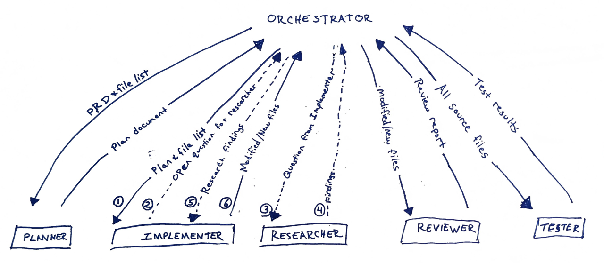

## Handoff summary

1. The `orchestrator` invokes the `planner` with `PRD.md`.
2. **After human approval:** The `orchestrator` sends the resulting plan and file list to the `implementer`.
3. If the `implementer` has a question in need of research:
   1. The `implementer` sends the question to the `orchestrator`.
   2. The `orchestrator` sends it to the `researcher`.
   3. The `researcher` researches online and sends its findings to the `orchestrator`.
   4.  The `orchestrator` passes the findings to the `implementer`.
4. The `orchestrator` sends modified and/or new files to the `reviewer`.
5. The `orchestrator` sends all source files to the `tester`.